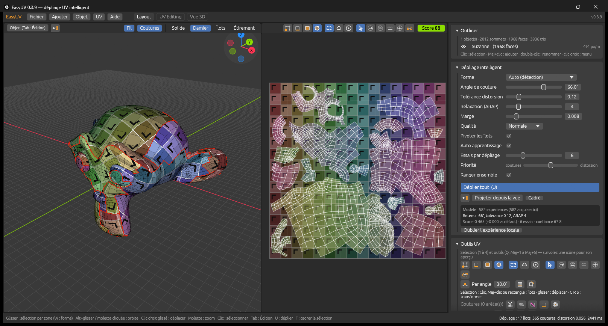

**English** · [Français](README.fr.md)

# EasyUV

Smart automatic UV unwrapping, written in Rust: a **Windows app**, a **command-line tool** and a **Blender add-on** sharing the same engine.



- Seams placed automatically, low-distortion unwrapping (LSCM + ARAP).
- Uniform texel density, controllable in px/m.
- Checker preview.
- Blender-inspired interface.
- Automatic updates with every release.

> The app's interface is currently in French. Menu names are given below with their French label in parentheses.

## Download

From the [releases](https://github.com/lburdier/EasyUV/releases/latest) page:

| File | Contents |
|---|---|
| `EasyUV-windows-x64.zip` | App + `easyuv-cli.exe` |
| `easyuv-blender-<version>.zip` | Blender extension, 4.2+ / 5.x |

### Automatic updates

- **App:** on startup, EasyUV checks the latest GitHub release. If a newer version exists, an orange "Update available" (*Mise à jour disponible*) button appears. Installing downloads the new executable, **checks its SHA-256 hash**, replaces it and restarts the app. *Help > Check for updates* (*Aide > Vérifier les mises à jour*) does the same on demand. To turn off the startup check, set `EASYUV_NO_UPDATE=1`.
- **Blender:** *Preferences > Get Extensions > Repositories > `+` > Add Remote Repository*, URL:
  `https://github.com/lburdier/EasyUV/releases/latest/download/index.json`
  Tick *Check for Updates on Startup*: Blender will offer every new version.

## How the unwrapper decides

1. **Initial seams:** sharp edges (adjustable dihedral angle), seams already marked, non-manifold geometry.
2. **Topology:** every island must be a disc.
   - tube (arm, cylinder) → a single seam, along the least visible path between its borders, preferably in a crease;
   - closed or holed shape (sphere, torus) → geodesic partition whose boundary follows the creases.
3. **Unwrapping:** LSCM (conformal), then **ARAP** relaxation (preserves areas).
4. **Quality check:** an island that is too distorted or has flipped triangles is split again, recursively.
5. **Texel density:** islands are at real-world scale (world space, metres), so density is the same everywhere. Two modes: *Fill 0-1* or *Target density*.
6. **Several objects:** packed into one shared tile (same density for all) or one tile per object.
7. **Packing:** rotation that minimises the bounding box, then skyline packing with 90° rotation.

## Self-learning

EasyUV gets better the more it unwraps.

1. **Fingerprint.** Each mesh is described by a scale-invariant fingerprint: size, share of triangles, sharp edges, curvature, open borders, topology, shape.
2. **Prediction.** A kernel surrogate model uses past results on similar meshes to estimate how much each setting (seam angle, distortion tolerance, ARAP) improves on the factory settings.
3. **Trials.** EasyUV tries the prediction, the factory settings, your settings and a few variants in parallel, and keeps the best. Exploration decreases as confidence grows.
4. **Memory.** The measurements of each trial (distortion, seams, islands, fill, flips) are recorded and used for every following mesh.

The **Priority: seams ↔ distortion** slider changes the trade-off immediately, without retraining: measurements are stored raw and the score is recomputed.

The model lives in `%APPDATA%\EasyUV\apprentissage.txt`. It is shared by the app, the CLI and Blender, and is append-only. A pre-trained base model ships with EasyUV. To train it on your own models in one go:

```text
easyuv-cli --train D:\my_models --rounds 3      # train
easyuv-cli --eval D:\other_models               # measure the gain on unseen meshes
```

## Formats

| Format | Import | Export |
|---|---|---|
| OBJ (multi-object) | yes | yes |
| glTF / GLB | yes (quads rebuilt) | GLB |
| FBX | yes (native, via [ufbx](https://github.com/ufbx/ufbx)) | yes, through an installed Blender |

Object transforms are applied (world space). FBX and glTF are converted to Z-up and metres.

## App

Shortcuts:

| Key | Action |
|---|---|
| `U` | Unwrap |
| `F` / `Home` | Frame selection / everything (in the view under the cursor) |
| Click + drag | Area selection: box, lasso or circle (`W` to switch, `[` `]`: circle radius), `Shift` adds, `Ctrl` removes. Objects in Object mode; vertices, edges, faces or islands in Edit mode |
| `Alt` + drag / middle click | Orbit |
| Right-drag / `Shift` + middle click | Pan |
| Mouse wheel | Zoom |
| `Ctrl+O` / `Ctrl+I` / `Ctrl+S` | Open / import into the scene / export |

Drag and drop a file to open it, with `Shift` to add it to the scene. Display modes: Solid, Checker, Islands, Stretch.

### UV tools

"UV Tools" panel, UV menu and right click in the UV editor, in the spirit of Maya's UV Toolkit and RizomUV.

Selection modes, as in Blender: vertices `1`, edges `2` (double-click: loop), faces `3`, islands `4`. With a selection, `U` unwraps only that selection; `Shift+U` unwraps the objects.

| Tool (key in the UV editor) | Effect |
|---|---|
| Select `Q` | click, `Shift`+click, box; drag, `G` `R` `S` to transform |
| Move brush `Shift+1` | pulls the UVs under the brush, with falloff towards the edge |
| Relax brush `Shift+2` | edges return to their 3D length (less stretching) |
| Straighten brush `Shift+3` | edges snap to the nearest horizontal or vertical: straightens the painted area |
| Pinch brush `Shift+4` | pulls UVs towards the centre, `Shift` to push them apart |
| Rectangle `Shift+5` | draw a rectangle: the selected island is straightened, then stretched to fill it |

Seams (on the selected edges): Cut, Sew (bring islands together and weld them), Mark seam for future unwraps, Clear seam.

Area selection: box, lasso or circle (`W`), `Shift` to add, `Ctrl` to remove. Select by angle: sharp edges (edge mode) or faces of the same flat area.

3D view like Blender: clickable gizmo and numpad for orthographic axis views; `Tab` puts the selected objects in Edit mode, where you pick their vertices, edges and faces on the model (`Alt`+click: loop, `L` / `Ctrl+L`: linked, `Ctrl+E`: seam).

Project from view: UVs take what you see in the 3D view (like Blender's Project From View), placed in the free space or stretched over the tile (Fit).

Perfect grid (`Shift+G`): rows and columns on straight lines. Straighten orientation: islands rotated according to their edges.

Make straight (`Shift+W`): quad grid, unrolled arc or rectangle with a pinned border; the least distorted method wins. In vertex mode, 4 vertices picked on the border of a strip become its fixed corners.

**Lines and faces, exactly where you choose** (*UV Tools* panel, *UV* menu or right click > *Lines and faces*):

| Tool | On a selection of… | Effect |
|---|---|---|
| Smooth | vertices, edges, faces or islands | edges return to their 3D length and ripples disappear; repeat to smooth further |
| Make straight | vertices or edges (an open line: part of a loop, a row) | the line becomes straight in the direction of its two ends, keeping its length; vertices spaced by their 3D lengths |
| Make straight | faces | faces are arranged in a straight grid |
| Make straight | islands | like `Shift+W`: the strip or arc becomes straight |
| Horizontal / vertical line | vertices or edges | the line becomes straight and lies along U or V |

Surrounding faces are recomputed from the 3D shape to follow the straightened line (first near the line, then across the whole island if needed); other islands don't move, and an isolated area (`H`) is respected. A closed loop (around an eye) cannot become straight. A strongly curved line in the middle of an island will fold a few faces: a message tells you, and `Ctrl+Z` undoes it. With a brush active, double-clicking an edge also selects its loop.

Checkers: Colour, Mono, Numbered, Circles, Arrows, UV gradient, Diagonals. Selected islands and the island under the cursor in the UV editor are highlighted on the 3D model.

The UV score (out of 100) is shown live in the UV editor's header: distortion, overlaps, flipped faces, fill, even density, seams.

Brush radius: `[` `]` or `Ctrl`+wheel. `Esc` cancels the stroke, `Ctrl+Z` afterwards.

**Brush area.** Brushes only affect the selection: an island (click), faces or vertices. Everything else is frozen and dimmed on screen. With no selection, everything visible can move. Vertices shared with a face outside the area stay frozen, so neighbouring faces don't get distorted.

**Isolate an area.** `H` (or *UV > Isolate selection*) freezes everything except the selection. The area stays isolated when you change the selection, and `G` / `R` / `S` stay inside it too. `Alt+H` releases it.

Island tools (on the selection): align (left, centre, right, top, bottom), distribute along U or V, rotate by an angle, mirror, scale, stack, equalise density, fill the tile, make straight, orient, optimise (ARAP), re-unwrap.

## Command line

```text
easyuv-cli model.fbx                           # -> model_uv.obj
easyuv-cli a.glb b.obj -o scene.glb            # one scene, shared packing
easyuv-cli folder\ --format fbx --separate     # batch processing
easyuv-cli x.obj --density 512 --tex 2048      # target density 512 px/m
easyuv-cli --check-update | --self-update
```

## Blender

Panel: 3D View → `N` sidebar → **EasyUV** tab (also in the UV editor). Shortcut `Alt+U` in Edit mode, and the `U` menu → *Smart unwrap*.

Features:
- unwrap the selection, all together or object by object;
- respects existing seams and sharp edges;
- marks the computed seams;
- measure, copy and apply texel density;
- toggle the checker on and off, restoring the original materials.

## Build

Requirements: stable Rust (MSVC), Python 3.11+, and Blender for the add-on tests.

```powershell
.\build.ps1                                   # build and prepare dist\
cargo test --release --workspace
blender --background --factory-startup --python tests\blender_test.py
blender --background --factory-startup --python tests\make_models.py   # test models
```

| Folder | Role |
|---|---|
| `crates/easyuv-core` | Engine (no dependencies) + C API `easyuv.dll` |
| `crates/easyuv-app` | egui app, `easyuv-cli`, import / export, updates |
| `blender_addon/easyuv` | Blender extension (ctypes → `easyuv.dll`) |
| `tools/package.py` | Release assets + Blender extension repository index |

## Releasing

1. Set the same version in `Cargo.toml`, `blender_addon/easyuv/blender_manifest.toml` and `bl_info`.
2. Add a `## [x.y.z]` section to `CHANGELOG.md`.
3. Run `git tag vx.y.z && git push origin vx.y.z`.

GitHub Actions tests, builds and publishes the release. The app and Blender then offer it automatically.

## Contributing

Issues and pull requests are welcome, in English or French. Run `cargo test --release --workspace` before opening a PR.

## License

[GPL-3.0-or-later](LICENSE), compatible with the Blender ecosystem.
